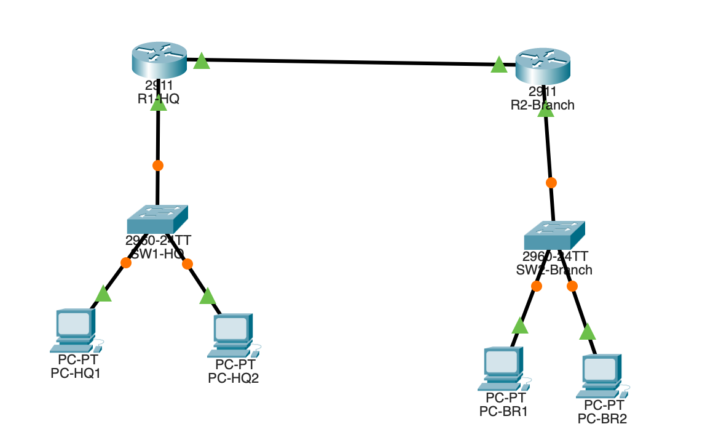

# Day 02 — Interfaces and Cables

**Project:** Jeremy's IT Lab — CCNA 200-301  
**Lab ID:** Day 02  
**Completion Date:** 2026-10-24  
**Status:** Completed  
**Platform:** Cisco Packet Tracer  
**Lab Type:** Guided  
**Related Reading:** *Acing the CCNA Exam, Volume 1*, Chapter 3

## 1. Lab Overview

### Objective

Develop foundational knowledge of network interfaces, Ethernet cabling, and physical connectivity through a guided Cisco Packet Tracer exercise.

### Scope

This exercise focuses on recognizing network interfaces and selecting appropriate cables for physical network connections.

Router configuration, IPv4 addressing, routing, and higher-layer network services were outside the documented scope of this lab.

## 2. Learning Objectives

- Identify common Ethernet cables and connectors.
- Understand copper and fiber-optic network connections.
- Recognize Cisco Ethernet interfaces and naming conventions.
- Select appropriate cables for network connections.
- Understand basic Ethernet speeds and distance limitations.
- Recognize physical interface compatibility considerations.

## 3. Network Topology

### Topology Diagram

### Devices and Equipment

The guided exercise was completed using Cisco Packet Tracer.

The completed network topology is documented in the diagram above, and the associated Packet Tracer project file is included in this directory.

Detailed device models and interface assignments can be inspected directly in the Packet Tracer project.

### Architecture

The exercise provided hands-on practice identifying network interfaces and selecting appropriate cables to establish physical connections.

The topology diagram and accompanying Packet Tracer project provide supporting documentation of the completed exercise.

## 4. Addressing and Design

### Network Allocation

Not applicable. This exercise focused on physical connectivity rather than IPv4 subnet allocation or VLAN design.

### Device Addressing

Not applicable. No device IP addressing was documented for this exercise.

### Physical Connectivity Concepts

**Copper Ethernet**

- Twisted-pair Ethernet cabling
- RJ-45 connectors
- Straight-through and crossover cable concepts
- Ethernet interface speeds and distance limitations

**Fiber-Optic Ethernet**

- Single-mode and multimode fiber
- Optical transceivers
- Fiber distance and application considerations

**Network Interfaces**

- Cisco interface naming conventions
- Ethernet interface identification
- Physical interface compatibility

## 5. Implementation

### Configuration Summary

Completed the guided Cisco Packet Tracer exercise accompanying Jeremy's IT Lab Day 02.

The exercise involved identifying network interfaces and selecting appropriate cables for physical network connections.

The completed Packet Tracer project was retained as supporting evidence of the exercise.

### Device Configurations

Not applicable. No Cisco IOS configuration commands were documented as part of this exercise.

## 6. Verification and Testing

### Verification Commands

Not applicable. No CLI verification commands were recorded for this exercise.

### Test Results

| Test | Expected Result | Observed Result | Status |
|---|---|---|---|
| Guided Packet Tracer exercise | Complete cabling activity | Exercise completed | Pass |
| Course walkthrough comparison | Review completed work against walkthrough | Comparison completed | Pass |

### Evidence

The completed exercise was compared with the course's lab walkthrough.

Supporting evidence includes:

- The completed Cisco Packet Tracer project file
- The network topology screenshot embedded in Section 3
- The documented learning objectives and technical concepts

No CLI verification outputs or interface-status logs were retained.

## 7. Troubleshooting

No specific troubleshooting incidents were recorded during this exercise.

The lab reinforced the importance of checking physical connections, cable compatibility, and interface selection when investigating network connectivity problems.

## 8. Key Concepts and Lessons Learned

### Copper vs. Fiber-Optic Cabling

Copper Ethernet and fiber-optic Ethernet use different transmission media, connectors, and interface hardware.

Cable selection depends on factors such as equipment compatibility, required speed, and transmission distance.

### Interface Identification

Understanding Cisco interface naming conventions helps identify physical ports and establish appropriate device connections.

### Physical Layer Fundamentals

Physical connectivity must be established before higher-layer network communication can function.

### Engineering Takeaways

- Identify the interface type before selecting a cable.
- Consider connector and transceiver compatibility.
- Understand the basic applications of copper and fiber-optic cabling.
- Verify physical connectivity before troubleshooting higher-layer protocols.
- Retain completed lab files and topology diagrams to support technical documentation.

## 9. Lab Outcome

**Final Status:** Completed

Successfully completed the guided Cisco Packet Tracer cabling exercise and reviewed the results against the course walkthrough.

The activity reinforced fundamental Ethernet cabling, interface identification, and physical connectivity concepts.

### Limitations

- Detailed device inventory and interface assignments are not listed in this report; the topology and Packet Tracer project are provided for inspection.
- No IP addressing or router configuration was recorded.
- No CLI verification outputs were retained.
- No specific troubleshooting incidents were documented.

## 10. Supporting Files and References

### Supporting Files

- [Completed Packet Tracer Lab](Day%2002%20-%20Lab%2001%20-%20Two%20Site%20Network.pkt)
- [Day 02 Network Topology](CCNA_Day02_Topology.png)
- This README documenting the guided exercise and learning outcomes

### References and Attribution

- [Jeremy's IT Lab — CCNA Course](https://www.youtube.com/@JeremysITLab)
- *Acing the CCNA Exam, Volume 1*, Chapter 3

This lab was completed as a guided exercise based on Jeremy's IT Lab course materials.

The documentation describes my own learning and completion of the exercise. Original course materials are not redistributed.

### Next Steps

Continue with Jeremy's IT Lab Day 03 and subsequent CCNA coursework.

Future hands-on exercises will be documented using the same standardized lab report format.

---

*Documented using Network Engineering Lab Report Standard v1.0.*
